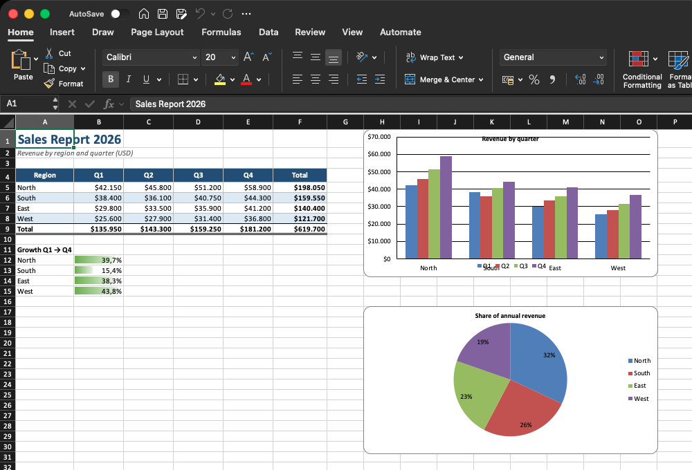
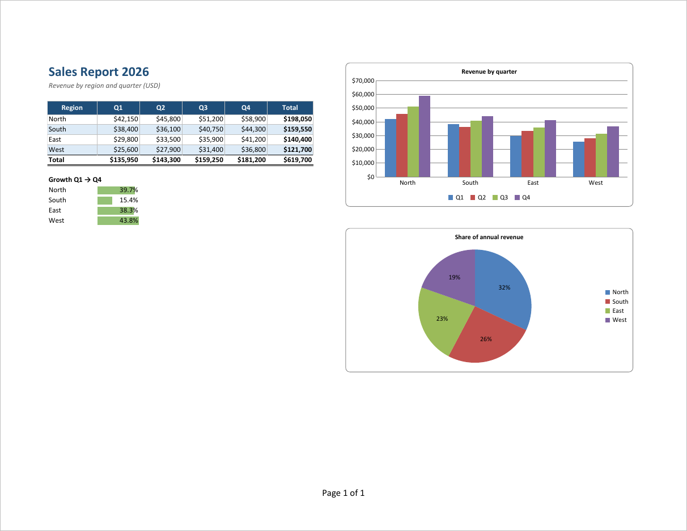
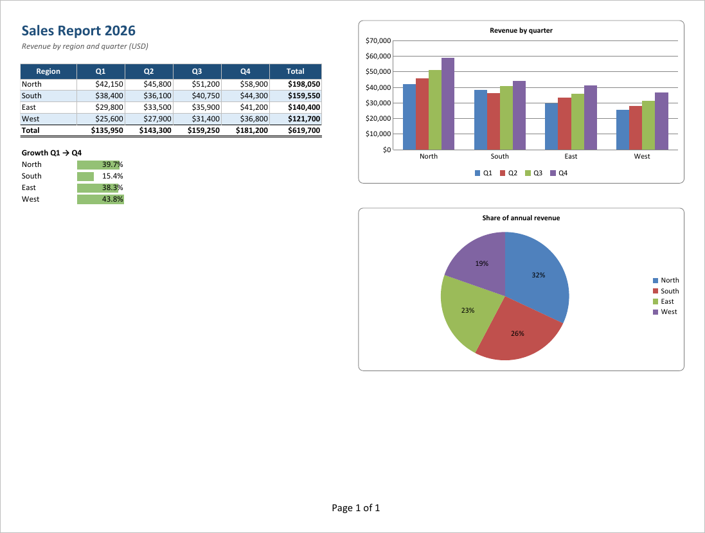
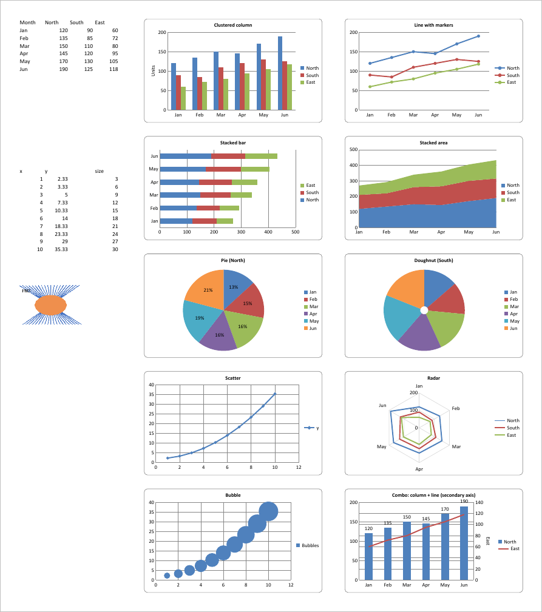
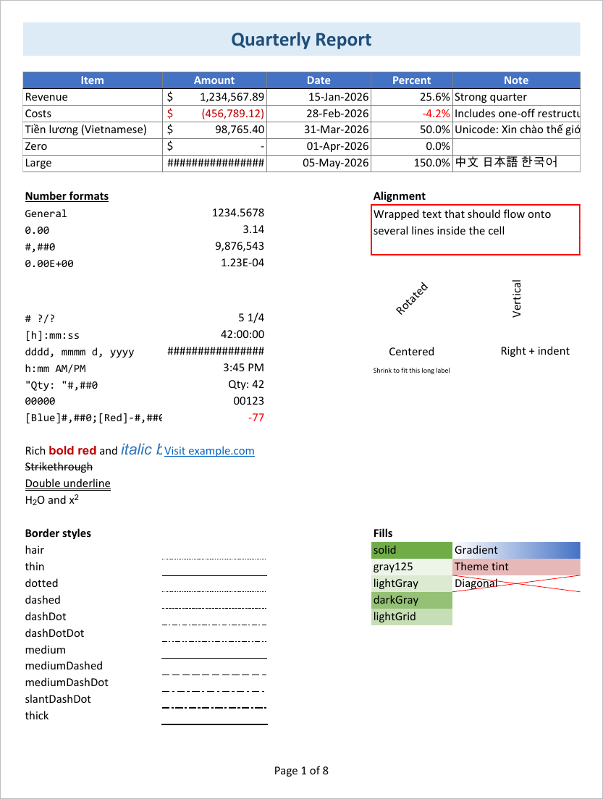

# excel2pdf

MIT-licensed libraries that convert Excel workbooks to PDF, for Python and .NET.

| Package | Status | Folder |
|---|---|---|
| Python | v0.1.0, working (install from GitHub, see below) | [python/](python/README.md) |
| .NET (`dotnet add package Excel2Pdf`) | planned: port of the Python renderer | `dotnet/` |

Both packages are pure-language: users install the package and import it.
Nothing else needs to be installed. An optional *capture* engine can hand the
workbook to Microsoft Excel or LibreOffice when one is already installed.

## Install (Python)

The package is not on PyPI yet, so install it straight from this repository
(needs Python 3.9+ and Git):

```bash
pip install "git+https://github.com/phuctr2203/excel2pdf.git#subdirectory=python"
```

Once it is published on PyPI this will become `pip install excel2pdf`.

## Example

```python
import excel2pdf

excel2pdf.convert("samples/sales-report.xlsx", "sales-report.pdf")
```

| The workbook in Microsoft Excel | The PDF written by excel2pdf |
|---|---|
|  |  |

Input: [samples/sales-report.xlsx](samples/sales-report.xlsx). Output:
[docs/sales-report.pdf](docs/sales-report.pdf). The table styles, number
formats, data bars, both charts, landscape fit-to-page setup and the
"Page 1 of 1" footer all come from the workbook. The screenshot's Excel uses a
European locale (`$42.150`); excel2pdf writes US separators (`$42,150`).

## Results

PDF pages produced by excel2pdf from the workbooks in [samples/](samples/).
Click a title to open the full PDF.

### [Sales report](docs/sales-report.pdf)

From [samples/sales-report.xlsx](samples/sales-report.xlsx): styled table,
currency formats, data bars, a column chart and a pie chart on one landscape page.



### [Charts](docs/charts.pdf)

From [samples/charts.xlsx](samples/charts.xlsx), fitted on one A3 page
(`excel2pdf charts.xlsx --fit-page --paper A3`): clustered column, stacked bar,
line, stacked area, pie, doughnut, scatter, radar, bubble, and a column + line
combo with a secondary axis, plus an embedded PNG picture.



### [Formatting](docs/formatting.pdf)

Page 1 of 8 from [samples/formatting.xlsx](samples/formatting.xlsx): accounting
and date formats, Vietnamese and CJK text, rich text, merged and wrapped cells,
rotated text, every border style, pattern and gradient fills. The other pages
cover conditional formatting and a 120-row table with repeated header rows,
gridlines, headers and footers.



## Layout

```
LICENSE            MIT
python/            Python package (src/excel2pdf), tests, README
samples/           sample workbooks generated by python/tests/make_samples.py
docs/              README images and the example PDFs
```

## Development (Python)

```bash
cd python
uv venv && uv pip install -e ".[test]"
.venv/bin/python tests/make_samples.py   # writes ../samples/*.xlsx
.venv/bin/python -m pytest
```

All runtime dependencies are permissive and MIT-compatible: openpyxl (MIT),
ReportLab (BSD), Pillow (MIT-CMU), fontTools (MIT).
